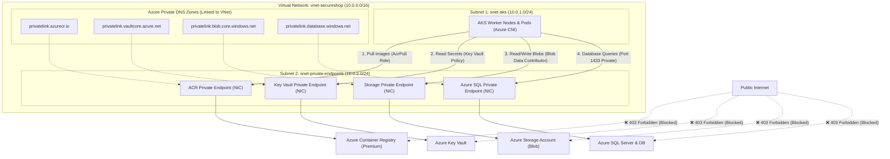

# 🛡️ Secure Shop: Enterprise Zero-Trust Azure Infrastructure

A fully automated, production-ready Infrastructure as Code (IaC) implementation designed with a **Zero-Trust, Private-by-Default** security posture. This project provisions an enterprise Kubernetes environment integrated with private Azure cloud services, isolated from public internet exposure.

---

## 📑 Table of Contents

- [Architectural Overview](#-architectural-overview)
- [Architecture Diagram](#-architecture-diagram)
- [Detailed Resource Breakdown](#-detailed-resource-breakdown)
  - [1. Resource Group](#1-resource-group)
  - [2. Virtual Network & Subnets](#2-virtual-network--subnets)
  - [3. Azure Kubernetes Service (AKS)](#3-azure-kubernetes-service-aks)
  - [4. Azure Container Registry (ACR)](#4-azure-container-registry-acr)
  - [5. Azure Key Vault](#5-azure-key-vault)
  - [6. Azure Storage Account](#6-azure-storage-account)
  - [7. Azure SQL Database](#7-azure-sql-database)
  - [8. Azure Private DNS Zones](#8-azure-private-dns-zones)
  - [9. IAM, Managed Identities & Role Assignments](#9-iam-managed-identities--role-assignments)
- [File Structure](#-file-structure)
- [Deployment Guide](#-deployment-guide)
  - [Option A: Terraform (Recommended)](#option-a-terraform-recommended)
  - [Option B: Azure CLI Script](#option-b-azure-cli-script)
- [Verification & Validation Guide](#-verification--validation-guide)
- [Application Integration & Secret Consumption](#-application-integration--secret-consumption)
- [Zero-Trust Security Principles Applied](#-zero-trust-security-principles-applied)

---

## 🏛️ Architectural Overview

In this design, all backend platform services (**Container Registry**, **Key Vault**, **Storage Account**, and **SQL Database**) have their public internet access explicitly disabled. Instead, they expose dedicated **Azure Private Endpoints** (virtual network interfaces with private IP addresses) inside a designated subnet within the customer's Virtual Network. 

Worker nodes and application pods hosted on **Azure Kubernetes Service (AKS)** communicate with these services entirely over Azure's private backbone network using Azure Private DNS Zones for seamless hostname resolution.

---

## 📊 Architecture Diagram



---

## 🔍 Detailed Resource Breakdown

### 1. Resource Group
- **Resource**: `azurerm_resource_group.rg`
- **Default Name**: `rg-secureshop-prod`
- **Region**: `centralindia` (configurable)
- **Role**: Serves as the logical lifecycle boundary. Deleting this resource group guarantees clean, complete teardown of all provisioned cloud resources.

### 2. Virtual Network & Subnets
- **VNet (`azurerm_virtual_network.vnet`)**:
  - Address Space: `10.0.0.0/16` (65,536 private IP addresses).
  - Isolates all internal resources from unauthorized network traffic.
- **Subnet 1 - AKS Cluster (`azurerm_subnet.aks`)**:
  - Address Prefix: `10.0.1.0/24` (251 usable host IPs).
  - Dedicated exclusively to AKS worker nodes and pod IP allocation (via Azure CNI).
- **Subnet 2 - Private Endpoints (`azurerm_subnet.pe`)**:
  - Address Prefix: `10.0.2.0/24` (251 usable host IPs).
  - Dedicated exclusively to Private Link network interfaces (NICs) for ACR, Key Vault, Storage, and SQL Server.
  - Keeps compute and service endpoints segmented for granular Network Security Group (NSG) control.

### 3. Azure Kubernetes Service (AKS)
- **Resource**: `azurerm_kubernetes_cluster.aks`
- **Default Name**: `aks-secureshop`
- **Node Pool**:
  - VM Size: `Standard_D2s_v3` (2 vCPUs, 8 GiB RAM per node).
  - Node Count: 2 nodes (configurable in variables).
  - Subnet Attachment: Directly bound to `snet-aks`.
- **Networking**:
  - Network Plugin: `azure` (Azure CNI) — pods receive real, routable IP addresses directly from the subnet.
  - Load Balancer SKU: `standard`.
- **Identity**: Configured with a dedicated User-Assigned Managed Identity (`azurerm_user_assigned_identity.aks_identity`), eliminating circular dependencies during subnet role assignment.

### 4. Azure Container Registry (ACR)
- **Resource**: `azurerm_container_registry.acr`
- **SKU**: `Premium` (required for Private Link and network isolation).
- **Security**:
  - `public_network_access_enabled = false`: Public internet requests are rejected with HTTP 403 Forbidden.
  - `admin_enabled = false`: Disables static admin passwords; all authentication relies on Azure Active Directory and Managed Identities.
- **Private Endpoint**: Attached in `snet-private-endpoints` with subresource `registry`.
- **DNS**: Linked to `privatelink.azurecr.io`.

### 5. Azure Key Vault
- **Resource**: `azurerm_key_vault.kv`
- **SKU**: `standard`
- **Security**:
  - Soft Delete Retention: 7 days.
  - Network ACLs: Default action set to `Deny`, bypassing only trusted `AzureServices`.
  - Private Endpoint: Attached in `snet-private-endpoints` with subresource `vault`.
- **Pre-seeded Secrets**:
  - `sql-admin-password`: 16-character cryptographically generated password.
  - `sql-connection-string`: Ready-to-use ADO.NET / JDBC formatted connection string.
- **Access Policies**:
  - Current Deployer: Full secret lifecycle permissions (`Get`, `List`, `Set`, `Delete`, `Purge`).
  - AKS Managed Identity: Read-only access (`Get`, `List`).

### 6. Azure Storage Account
- **Resource**: `azurerm_storage_account.storage`
- **SKU**: `Standard_LRS`
- **Security**:
  - `public_network_access_enabled = false`: All public endpoints are completely shut off.
  - `allow_nested_items_to_be_public = false`: Prevents inadvertent public blob exposures.
  - `min_tls_version = TLS1_2`: Enforces modern transport layer encryption.
- **Containers**: Includes a private container named `appdata`.
- **Private Endpoint**: Attached in `snet-private-endpoints` with subresource `blob`.
- **DNS**: Linked to `privatelink.blob.core.windows.net`.

### 7. Azure SQL Database
- **Resources**: `azurerm_mssql_server.sql` and `azurerm_mssql_database.db`
- **Database Name**: `secureshopdb`
- **SKU**: `Basic` (cost-efficient starting tier, easily upgraded to Standard/General Purpose).
- **Security**:
  - `public_network_access_enabled = false`: Blocks all internet traffic to SQL port 1433.
  - Password Management: Generated via `random_password` and immediately stored in Key Vault.
- **Private Endpoint**: Attached in `snet-private-endpoints` with subresource `sqlServer`.
- **DNS**: Linked to `privatelink.database.windows.net`.

### 8. Azure Private DNS Zones
Four dedicated Private DNS Zones are created and automatically linked to `vnet-secureshop`:
1. `privatelink.azurecr.io` (for ACR)
2. `privatelink.vaultcore.azure.net` (for Key Vault)
3. `privatelink.blob.core.windows.net` (for Storage Blobs)
4. `privatelink.database.windows.net` (for Azure SQL Database)

### 9. IAM, Managed Identities & Role Assignments

| Role Definition | Assignee | Scope | Architectural Purpose |
| :--- | :--- | :--- | :--- |
| **`AcrPull`** | AKS Kubelet Identity (`kubelet_identity[0].object_id`) | ACR Resource ID | Allows worker nodes to pull container images without managing docker secrets. |
| **`Network Contributor`** | AKS Control Plane Identity (`aks_identity.principal_id`) | Subnet 1 (`snet-aks`) | Required by Azure CNI to allocate subnet IPs to pods and join NICs. |
| **`Storage Blob Data Contributor`** | AKS Control Plane Identity (`aks_identity.principal_id`) | Storage Account Resource ID | Allows workloads running in AKS to read/write blobs using AAD tokens without access keys. |
| **Key Vault Access Policy (`Get`, `List`)** | AKS Control Plane Identity (`aks_identity.principal_id`) | Key Vault Resource ID | Allows pods to fetch database credentials and connection strings at runtime. |

---

## 📁 File Structure

```text
Secure Shop/
├── .gitignore               # Excludes .tfstate, *.tfvars, crash logs, and local caches
├── main.tf                  # Comprehensive IaC (RG, VNet, Subnets, AKS, ACR, KV, Storage, DB, DNS, Roles)
├── variables.tf             # Parameter declarations with types, defaults, and descriptions
├── outputs.tf               # Exported endpoints, private IPs, and helper commands
├── terraform.tfvars         # Active local configuration file
├── terraform.tfvars.example # Reference template for customizable inputs
├── deploy-azure-cli.ps1     # 1-click alternative deployment script using Azure CLI
└── README.md                # This complete documentation
```

---

## 🚀 Deployment Guide

> [!IMPORTANT]
> Ensure you have an active Azure subscription and appropriate RBAC permissions (`Owner` or `Contributor` + `User Access Administrator` on the subscription/resource group).

### Option A: Terraform (Recommended)

1. **Login to Azure**:
   ```powershell
   az login
   az account set --subscription "<YOUR_SUBSCRIPTION_ID>"
   ```

2. **Review or customize values**:
   Inspect [**`terraform.tfvars`**](file:///c:/Users/Gaurav%20Shukla/Desktop/Code/New%20Era%20code/Secure%20Shop/terraform.tfvars) and adjust the location or naming prefix if desired.

3. **Initialize Terraform**:
   ```powershell
   terraform init
   ```

4. **Review the Execution Plan**:
   ```powershell
   terraform plan
   ```

5. **Apply Infrastructure**:
   ```powershell
   terraform apply
   ```

---

### Option B: Azure CLI Script

If you prefer to deploy directly using the Azure CLI without maintaining Terraform state files:

```powershell
# Execute the automated PowerShell script
.\deploy-azure-cli.ps1
```

---

## ✅ Verification & Validation Guide

Once deployed, run these verification checks:

### 1. Verify AKS Cluster Access
```powershell
# Get credentials for kubectl
az aks get-credentials --resource-group rg-secureshop-prod --name aks-secureshop

# Verify nodes are Ready and have internal VNet IPs (10.0.1.x)
kubectl get nodes -o wide
```

### 2. Verify Private Isolation (External Negative Test)
From your local workstation terminal, attempt to query the resources:
```powershell
# Should fail with 403 Forbidden (proves public internet access is blocked)
az acr repository list --name <ACR_NAME>
az sql server show --name <SQL_SERVER_NAME> --resource-group rg-secureshop-prod --query publicNetworkAccess
```

### 3. Verify Internal DNS & Connectivity from Inside AKS
Spin up a lightweight debug pod inside the AKS cluster:
```powershell
kubectl run network-test --rm -i --tty --image=mcr.microsoft.com/azure-cli:latest -- bash
```
Inside the container, run DNS lookups:
```bash
# Verify internal DNS resolution to 10.0.2.x private endpoint IPs:
nslookup <ACR_NAME>.azurecr.io
nslookup <KEY_VAULT_NAME>.vault.azure.net
nslookup <STORAGE_ACCOUNT_NAME>.blob.core.windows.net
nslookup <SQL_SERVER_NAME>.database.windows.net
```

### 4. Verify AcrPull Role Assignment
```powershell
az role assignment list `
    --assignee $(az aks show -g rg-secureshop-prod -n aks-secureshop --query identityProfile.kubeletidentity.objectId -o tsv) `
    --role AcrPull `
    --output table
```

---

## 🔑 Application Integration & Secret Consumption

### How Kubernetes Pods Connect to the Database
Workloads do not need hardcoded database credentials in their manifests:
1. Pods can use the **Azure Key Vault Provider for Secrets Store CSI Driver** to mount secrets as files or environment variables.
2. The connection string `sql-connection-string` is readily available inside the Key Vault:
   ```text
   Server=tcp:<sql-server>.database.windows.net,1433;Initial Catalog=secureshopdb;Persist Security Info=False;User ID=sqladminuser;Password=<secret-password>;Encrypt=True;TrustServerCertificate=False;Connection Timeout=30;
   ```
3. Because the SQL Server is mapped via Private Link (`privatelink.database.windows.net`), the FQDN automatically resolves to the private IP in Subnet 2.

### How Kubernetes Pods Connect to Blob Storage
1. Pods authenticate via **Azure Workload Identity** or the AKS Managed Identity.
2. Because the identity possesses the `Storage Blob Data Contributor` role, the application can use the Azure SDK (`DefaultAzureCredential`) without managing storage access keys.

---

## 🔒 Zero-Trust Security Principles Applied

- **No Public IP Addresses on Services**: Key Vault, Storage, Database, and Container Registry have zero direct exposure to the public internet.
- **Principle of Least Privilege (PoLP)**:
  - AKS Kubelet identity only has `AcrPull` on ACR.
  - AKS Control Plane only has `Network Contributor` on the AKS Subnet (not the entire subscription or resource group).
  - Storage access uses Azure AD RBAC instead of shared storage access keys.
- **Encrypted in Transit & at Rest**: TLS 1.2 is enforced across all services.
- **Dedicated Subnet Segmentation**: Compute workloads (AKS) are separated from data/endpoint interfaces (Private Endpoints).

### 1. Verify AKS Cluster Access
```powershell
# Get credentials for kubectl
az aks get-credentials --resource-group rg-secureshop-prod --name aks-secureshop

# Verify nodes are Ready and have internal VNet IPs (10.0.1.x)
kubectl get nodes -o wide
```

### 2. Verify Private Isolation (External Negative Test)
From your local workstation terminal, attempt to query the resources:
```powershell
# Should fail with 403 Forbidden (proves public internet access is blocked)
az acr repository list --name <ACR_NAME>
az sql server show --name <SQL_SERVER_NAME> --resource-group rg-secureshop-prod --query publicNetworkAccess
```

### 3. Verify Internal DNS & Connectivity from Inside AKS
Spin up a lightweight debug pod inside the AKS cluster:
```powershell
kubectl run network-test --rm -i --tty --image=mcr.microsoft.com/azure-cli:latest -- bash
```
Inside the container, run DNS lookups:
```bash
# Verify internal DNS resolution to 10.0.2.x private endpoint IPs:
nslookup <ACR_NAME>.azurecr.io
nslookup <KEY_VAULT_NAME>.vault.azure.net
nslookup <STORAGE_ACCOUNT_NAME>.blob.core.windows.net
nslookup <SQL_SERVER_NAME>.database.windows.net
```

### 4. Verify AcrPull Role Assignment
```powershell
az role assignment list `
    --assignee $(az aks show -g rg-secureshop-prod -n aks-secureshop --query identityProfile.kubeletidentity.objectId -o tsv) `
    --role AcrPull `
    --output table
```

---

## 🔑 Application Integration & Secret Consumption

### How Kubernetes Pods Connect to the Database
Workloads do not need hardcoded database credentials in their manifests:
1. Pods can use the **Azure Key Vault Provider for Secrets Store CSI Driver** to mount secrets as files or environment variables.
2. The connection string `sql-connection-string` is readily available inside the Key Vault:
   ```text
   Server=tcp:<sql-server>.database.windows.net,1433;Initial Catalog=secureshopdb;Persist Security Info=False;User ID=sqladminuser;Password=<secret-password>;Encrypt=True;TrustServerCertificate=False;Connection Timeout=30;
   ```
3. Because the SQL Server is mapped via Private Link (`privatelink.database.windows.net`), the FQDN automatically resolves to the private IP in Subnet 2.

### How Kubernetes Pods Connect to Blob Storage
1. Pods authenticate via **Azure Workload Identity** or the AKS Managed Identity.
2. Because the identity possesses the `Storage Blob Data Contributor` role, the application can use the Azure SDK (`DefaultAzureCredential`) without managing storage access keys.

---

## 🔒 Zero-Trust Security Principles Applied

- **No Public IP Addresses on Services**: Key Vault, Storage, Database, and Container Registry have zero direct exposure to the public internet.
- **Principle of Least Privilege (PoLP)**:
  - AKS Kubelet identity only has `AcrPull` on ACR.
  - AKS Control Plane only has `Network Contributor` on the AKS Subnet (not the entire subscription or resource group).
  - Storage access uses Azure AD RBAC instead of shared storage access keys.
- **Encrypted in Transit & at Rest**: TLS 1.2 is enforced across all services.
- **Dedicated Subnet Segmentation**: Compute workloads (AKS) are separated from data/endpoint interfaces (Private Endpoints).

